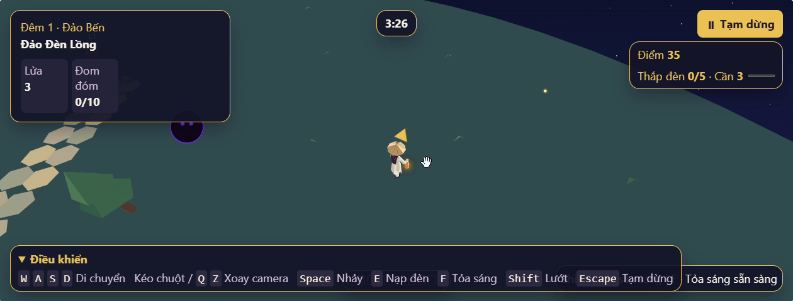

# Đảo Đèn Lồng · v1.0.0

[Video demo CP5](docs/demo/demo.mp4)



Điều khiển Mây qua Đảo Bến, Đảo Cau và Đảo Chuông. Gom đom đóm và giữ đủ đèn sáng tới bình minh.

## Chạy game

Cần Node.js 20+ và trình duyệt hiện đại. Mở terminal trong thư mục chứa `serve.mjs`:

```bash
node serve.mjs
```

Mở http://127.0.0.1:8000 rồi chọn **Bắt đầu**. Dùng **WASD** hoặc phím mũi tên để di chuyển, kéo chuột hoặc **Q/Z** để xoay camera, **Space** để nhảy, **Shift** để lướt, **E** để nạp đèn, **F** để Tỏa Sáng và **Esc/P** để tạm dừng.

- Giữ ít nhất 3/5, 4/6 và 5/7 đèn sáng ở bình minh. Châm dầu bằng E. Đèn thắp mới cần 10 đom đóm, thắp lại cần 5.
- Bảng màu dễ phân biệt bật trong Cài đặt và được lưu. Đèn yếu nhấp nháy. Đèn tắt có thân xẹp và vết rách.
- Menu tạm dừng cho phép tiếp tục, chơi lại Đêm, chỉnh âm lượng và độ nhạy chuột hoặc về menu chính. Hai thanh cài đặt được lưu trong trình duyệt.

## Sáng tạo của tôi

Mây mặc áo dài hai tà, để tóc dài và cầm đèn lồng ở tay phải. Mô hình dựng bằng hình học 3D trong mã nguồn.

## Kiểm chứng

```bash
node --test
node headless.mjs --seed 42 --night 3 --ticks 18000 --out run.jsonl
```

`--night` nhận 1, 2 hoặc 3. Dùng thêm `--scenario file.json`, `--inputs file.json` và `--snapshot-every 10` để tái tạo ca. Xem [tiêu chí nghiệm thu và kết quả CP3](docs/phase-3.md).

## Benchmark và soak

```bash
node bench.mjs --seed 42 --duration 30 --out bench.json
node --jitless --expose-gc soak.mjs --seed 7 --nights 10 --out soak.json
node serve.mjs --export-leaderboard leaderboard-export.json
```

Benchmark cần Chrome, Chromium hoặc Edge. Có thể đặt đường dẫn trình duyệt qua biến môi trường `BENCH_BROWSER`. Bản web dùng `requestAnimationFrame`, giữ VSync và ghi `peak_mem_mb: null` vì trang web không đọc được RSS. Dùng phiên desktop 1280×720 trở lên. `BENCH_HEADLESS=1` dành cho kiểm tra chẩn đoán, không dùng để so với số đo chấm desktop.

Soak chạy cùng một tiến trình Node, với seed của Đêm đầu là 7 và tăng 1 mỗi Đêm. Cờ `--jitless` tránh RSS tăng do biên dịch thích nghi của V8 trong phép đo 10 Đêm. GC được yêu cầu ở cả hai mốc đo RSS.

Bảng xếp hạng lưu ở `~/.dao-den-long/leaderboard.json`. Đặt biến `LANTERN_DATA_DIR` để đổi vị trí. Tùy chọn đổi phím, giảm chuyển động, chữ lớn và bảng màu nằm trong Cài đặt. Đổi phím, chữ lớn và giảm chuyển động được lưu theo trình duyệt.

Xem [báo cáo CP4](docs/phase-4.md) và [retro](docs/retro.md).

## Bản lưu và chế độ Sinh tồn

Menu chính có **Bắt đầu** và **Tiếp tục trò chơi**. Game giữ một bản lưu trong trình duyệt, tự lưu mỗi 5 giây khi chơi, khi tạm dừng và khi rời trang. Sang Đêm mới sẽ lưu ở đầu Đêm. Sau khi thua, bản lưu cho phép chơi lại Đêm đó.

Vòng vàng quanh đèn biểu thị vùng an toàn. Vòng biến mất khi đèn còn dưới 30 dầu hoặc tắt.

Thắng cả ba Đêm để mở **Sinh tồn · AK**. Xoay camera để ngắm, giữ **F** để bắn và nhấn **E** để nạp. Mỗi đom đóm cho một băng 30 viên, bắt đầu với một băng đã nạp. Mỗi giây sống sót được một điểm. Lượt Sinh tồn chơi riêng, điểm không cộng vào bảng xếp hạng chiến dịch.
